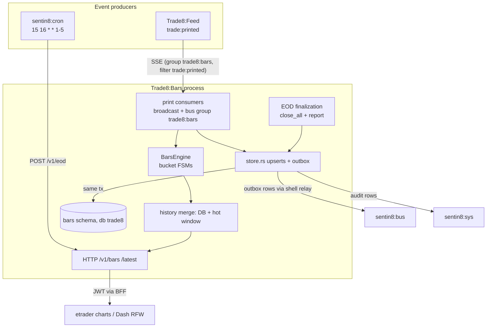

# Trade8:Bars - OHLCV Bar Aggregation Service

> Audience: anyone evaluating or onboarding to the service. For the
> wire-level construction read `DESIGN.md`; for business functionality read
> `BUSINESS.md`. Vertical context: the top-level `DESIGN.md`

> (system map) and `BUSINESS.md` (business view).

## 1. Summary

Trade8:Bars consumes consolidated trade prints (`trade8:feed:trade:printed`)
and aggregates OHLCV bars at standard intervals (1s, 1m, 5m, 15m, 1h, 1d),
serving both live charting (intrabar snapshots + closed bars) and historical
queries (DB window + engine hot window, merged and deduped), with EOD
finalization on the scheduled session close. Bars are the numeric substrate
for the Flutter chart stack - no rendering logic lives here.

## 2. Motivation

Charting history has three conflicting needs: **writes** (every print
touches every interval), **reads** (charts page months of history), and
**liveness** (traders watch the current candle move). The legacy stack
resolved this with per-interval file databases and a widget-side reader - a
solution that could not share tenancy, recover cleanly, or serve a mobile
app. Bars inverts it:

- **One aggregation core** folds prints into per-(symbol, interval) bucket
  state machines with market-clock alignment (session open = bucket 0), so
  charts align to the venue, not to UTC midnight.
- **Persistence at close**, not per print: closed bars upsert into interval
  tables; the engine's hot window covers live queries; history merges DB
  rows with the engine's current candles.
- **Rebuildability**: bars for any (symbol, interval, range) recompute from
  the print stream - storage is a projection, not the source.

## 3. Architecture & High-Level Design

## 4. Key Traits and Data Structures

- **`BarsState`** - shell core + engine + fan-out channel.
- **`BarsEngine`** (`core.rs`) - `open: (symbol, interval) → OpenBucket`
  state machines + `closed` hot-window log; `apply_print` (fold/cross-bucket
  close), `close_all` (EOD), `history` (hot read), `intrabar` (live candles);
  `bucket_start(ts, session_open, interval)` - market-clock alignment.
- **`Bar` / `BarInterval`** (`trade8::contracts::marketdata`) - OHLCV fold
  (`Bar::from_first` + `Bar::apply`) and the fixed interval set (S1…D1 with
  durations); ×10⁴ prices.
- **`store`** - bar upserts per interval table (merge on conflict: extend
  high/low, add volume/prints), history read (window), EOD report
  persist/read, NDJSON export, outbox events (`bar:closed`, `eod:completed`).
- **`consumers`** - the bus consumer (family `feed`, group `trade8:bars`,
  filter `trade8:feed:trade:printed`) + the in-broadcast demo consumer; both
  drive identical roll-up + persist paths.

## 5. Rationale, Trade-offs, and Alternatives

- **Persist on close, not per print.** Interval rows upsert at bucket close;
  intrabar values live in the engine. Rejected: per-print upserts (write
  amplification ×6 intervals), event-sourced-only history (chart paging
  would need replay).
- **Market-clock bucketing.** Session open anchors bucket 0 (matches
  venue-aligned charts). Rejected: UTC-wall-clock buckets (misaligned
  candles at sessions with non-midnight opens).
- **Six fixed intervals.** The service keeps 1s…1d; coarser intervals derive
  client-side from finer ones (4h from 1h). Rejected: N configurable
  intervals (state explosion, cache complexity).
- **DB-first history with hot-window fallback.** `GET /v1/bars` reads the DB
  window and merges the engine's fresh buckets, deduping on bucket start.
  Rejected: engine-only history (lost across restart), DB-only (stale
  current candle).
- **Mimalloc allocator** (master design §11) for the print hot loop.

## 6. Internal Implementation & Invariants (Private Design)

**Invariants** (unit + `tests/sql_matrix.rs`):

- A print belongs to exactly one bucket per interval; crossing into a later
  bucket closes the previous one and emits it exactly once.
- Close rides high/low correctly: an upserted bar merges (high = max,
  low = min, volume/print_count accumulate) - re-runs never degrade OHLCV.
- `close_all` (EOD) drains every open bucket exactly once; the EOD day
  report records prints, active symbols, completion, and archive refs.
- History dedupes on `bucket_start_ms` with the hot window winning - no
  phantom duplicate candles.
- Price fields are ×10⁴ instrument-scale ints end-to-end (DB BIGINT,
  engine i128, wire JSON `{raw, scale}`).
- Persistence paths set tenant context then `begin()` (transaction-local
  RLS context) with explicit env filters.
- Interval tables are identical shapes (`LIKE bar_1s INCLUDING ALL`) except
  `bar_1d` (adds vwap + official open/close semantics).

## 7. Unresolved Questions / Future Designs

- **Session-open anchor** - bucket anchors currently use the print's venue
  timestamp as the session-open sentinel (simplified anchor); wiring the
  real per-day session open (Desk calendar/Cron) into the consumer is open.
- **Cold-tier archiving** - the EOD report carries storage-object refs;
  the archive→rehydrate loop (columnar batches in Sentin8:Storage + LRU
  window) is designed but not yet exercised end-to-end.
- **Intrabar SSE** - `latest_bars` exposes the intrabar snapshot; a live
  intrabar push channel (SSE frames per interval tick, last-wins coalescing)
  is a follow-on to the one-way stream tier.
- **Official open/close policy** - EOD 1d finalize vs session no-print
  carry-forward rules (prior close with volume 0) still need product
  confirmation.
- **Interval config** - the boot interval set is fixed (1m/5m/1d); making
  the active set per-env configuration is open.

---

**Architecture & Design:** trade8:bars and its underlying concepts were designed by [Hamid Jahanzad](https://www.linkedin.com/in/hamidjahanzad/).
